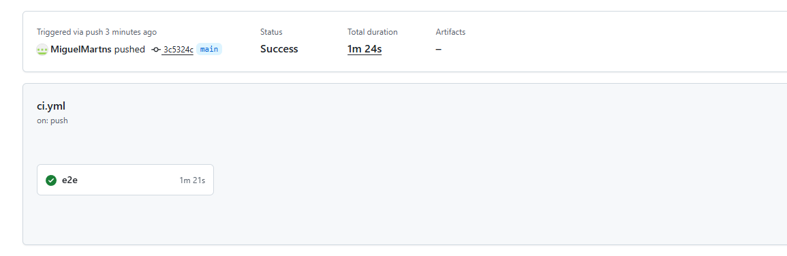
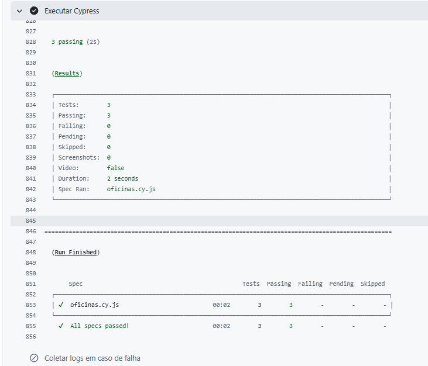

# Relatório — Prática Guiada QA e DevOps com TechLab

## Evidências de Execução
* **Status dos contêineres (`docker compose ps`):** 
* **Execução dos testes Cypress:** 

## Links das Execuções no GitHub Actions
1. **Execução Verde Inicial (2 testes):** https://github.com/MiguelMartns/techlab/actions/runs/45532015916
2. **Execução Vermelha (Detecção do defeito de lotação):** https://github.com/MiguelMartns/techlab/actions/runs/45532022716
3. **Execução Verde Final (3 testes após correção):** https://github.com/MiguelMartns/techlab/actions/runs/45532235180

## Análise do Defeito
* **Defeito:** Na função `inscrever` em `web/server.js`, a validação verificava se a quantidade de inscritos era estritamente maior (`>`) que o número de vagas da oficina, permitindo que um participante excedente se inscrevesse quando a oficina já estava no limite.
* **Resultado Esperado:** Ao tentar inscrever um segundo participante na oficina com 1 vaga, o sistema deveria rejeitar a operação e exibir a mensagem `"Oficina lotada."`.
* **Resultado Obtido:** O sistema aceitou a segunda inscrição, exibindo `"Inscrição confirmada."` e extrapolando a capacidade (`2 de 1 vagas ocupadas`). A correção alterou o operador relacional para maior ou igual (`>=`).

## Questões Teóricas

1. **Por que usar um volume para o PostgreSQL?**
   Contêineres são efêmeros; sem um volume (`dados`), todos os registros e tabelas do banco seriam perdidos sempre que o contêiner do PostgreSQL fosse recriado ou removido. O volume persiste os dados fora do ciclo de vida do contêiner.

2. **Por que o navegador do host usa `localhost:8080` enquanto o Cypress em Docker usa `web:3000`?**
   O mapeamento de portas (`127.0.0.1:8080:3000`) expõe a porta interna `3000` do contêiner na porta `8080` da máquina hospedeira (`localhost`). Já o contêiner do Cypress roda na mesma rede interna virtual do Docker Compose, onde os serviços se comunicam diretamente pelo nome do serviço (`web`) e pela porta nativa da aplicação (`3000`).

3. **Por que a primeira suíte verde não garantiu que todas as regras estavam corretas?**
   Porque testes automatizados validam apenas os cenários e asserções explicitamente escritos neles. A primeira suíte testava apenas o filtro de trilha e o fluxo feliz de inscrição em uma oficina com vagas disponíveis, sem cobrir o caso de borda de lotação máxima.

4. **Qual a diferença entre confirmação e regressão na última execução?**
   O **teste de confirmação** (reteste) verifica especificamente se o defeito corrigido foi resolvido — neste caso, o terceiro teste (`Limite de capacidade`) passando após a correção do operador `>=`. Já o **teste de regressão** garante que a alteração feita no código não quebrou funcionalidades existentes que já funcionavam antes — representado pelos dois primeiros testes (`filtra oficinas` e `confirma e persiste uma inscrição`) continuando verdes.